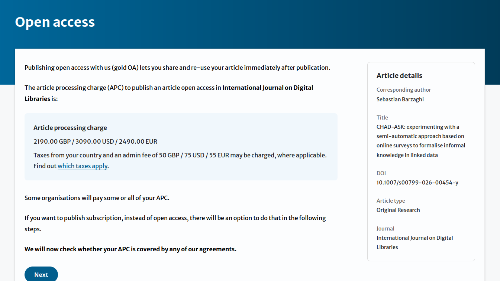
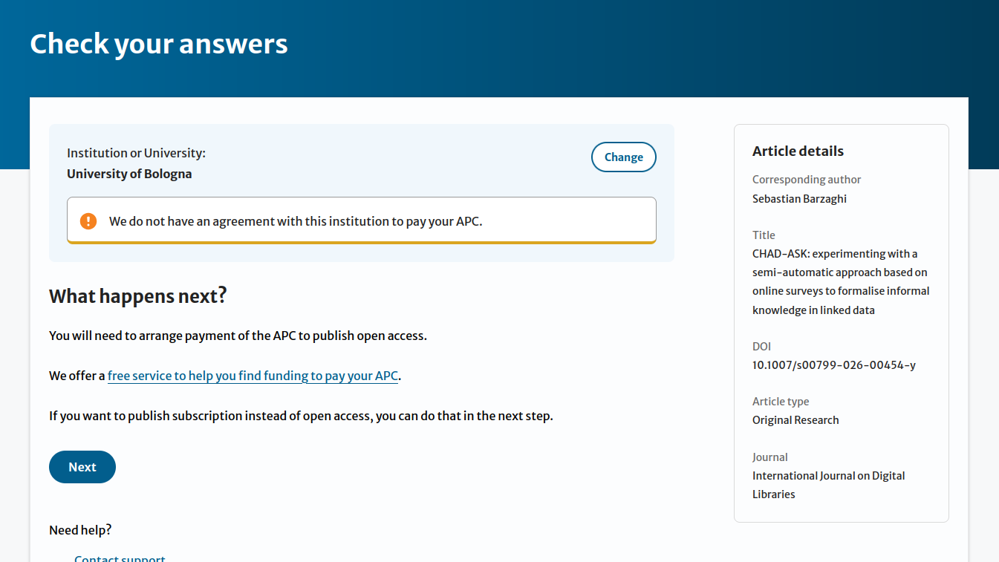

## CHAD-ASK

## FAIRsharing

* caricata MiTO; approvata e in attesa di DOI
* caricata TVC; approvata e in attesa di DOI
* caricata AMO; approvata e in attesa di DOI
* caricata Literal Reification; in attesa di approvazione

## PhD

Letture sul tema del riuso

### Challenges in tracking archive’s data reuse in social  sciences (Accordino et al. 2024)

**Full citation**: Accordino, F., Luzi, D., & Pecoraro, F. (2025). Challenges in tracking archive’s data reuse in social sciences. Digital Library Perspectives, 41(2), 189–206. https://doi.org/10.1108/DLP-07-2024-0112

Identifying data reuse is challenging, due to technical reasons, and in particular for incorrect citation practices among scholars.

This work proposes an automatic method to track the reuse of data deposited in the archives joined to the CESSDA (Consortium of European Social Science Data Archives)

Metadata of publications, and those of dataset, allow us to understand the characteristics and circumstances in which data reuse happens.

adopting a correct method to identify data reuse is difficult and challenges involve technical skills and depend on the adoption of good citation practices. Scientific literature illustrates some measurement methods 

The most accurate way is to track data citations in scientific publications

Data reuse is a complex sociotechnical process. It can be studied from different points of view, considering all actors, tools and practices involved, and the different specific purposes. Studies on data sharing and reuse apply quantitative and qualitative methods, focusing on behaviours, practices, and way of measurement.

Reuse indicates an action of managing collected data retrieved by a source, such an archive, with purposes different from those eventually established at the time of data collection, to provide new insight. It is a transformative act, that extracts added value from the original research and data in a creative way, going beyond the original meaning and intentions. This is also known as secondary use of data.

Data can be reused for different purposes, for instance: to compare different versions of a study, as teaching material, or to perform a new study.

Identifying reuse is useful to track the data impact as well as to evaluate quality of the research infrastructures involved

For scholars, monitoring the reuse of shared research data is useful to understand what kind of preparation and publication of data works well, for example what are the most important metadata, and to identify communities interested in their data.

The literature proposes models to measure the re-usability of data, in terms of compliance with the FAIR principles.

identifying reuse is difficult due the lack of procedures able to recognize it in an automatic manner and with a good level of accuracy.

A more accurate way to identify data reuse, suggested by numerous studies, is to measure the datasets citations retrievable in scientific publications, that are tangible forms, in other words, evident forms of reuse that is possible to track.

Data citation is a clear and incontestable measure, that demonstrates a use or interest by an author and it reveals its real impact. 

The explanatory limit of this approach is the impossibility to verify and distinguish the reasons of data citation and its different purposes: comment, validation, showing data.

different types of citing practices allow different possibilities of data traceability.

Grouping cited data authors by type

Grouping data by topics and publications by categories

Year of publication of data and articles

Most cited data

Principal investigator of datasets

Citing publications

Publications by year and time span from data

Data topics and publications’ subject area

### A method to track dataset reuse in biomedicine: filtered GEO accession numbers in PubMed Central (Piwowar 2010)

**Full citation**: Piwowar, H. A. (2010). A method to track dataset reuse in biomedicine: Filtered GEO accession numbers in PubMed Central. Proceedings of the American Society for Information Science and Technology, 47(1), 1–2. https://doi.org/10.1002/meet.14504701450

Reusing research data has important potential benefits: generative science and efficient resource use. 

Tracking the reuse of research datasets would allow us to understand whether the potential benefits are indeed realized, enable recognition of investigators who produce, annotate, and share useful data, and inform data sharing and reuse initiatives, tools, and policies.

Despite this need, little research has been done on patterns and prevalence of data reuse, outside case study descriptions (Zimmerman, 2003).

### Barriers and solutions to assessing digital library reuse:  preliminary findings (O'Gara et al 2018)

**Full citation**: O’Gara, G. M., Woolcott, L., Joan Kelly, E., Muglia, C., Stein, A., & Thompson, S. (2018). Barriers and solutions to assessing digital library reuse: Preliminary findings. Performance Measurement and Metrics, 19(3), 130–141. https://doi.org/10.1108/PMM-03-2018-0012

to reveal reuse assessment practices and requirements for digital assets held by cultural heritage and research organizations.

A key indicator of the impact of digital collections is content reuse, specifically how materials are utilized and repurposed. There have been ongoing efforts within the digital library community to demonstrate and measure reuse. These types of investigations have produced meaningful results, but efforts have been scattered among institutions and organization types. Additionally, in this relatively new arena, few recommended practices or gold standards have emerged.

a growing body of research on reuse patterns and practices among content related to work in the humanities and arts. It also identified a series of deficiencies, including: difficulty in identifying who uses digital libraries (sometimes due to user privacy safeguards) and how research focus (e.g. general vs scholarly use) affects how and what is reused; a lack of research on methods to track online reuse through hyperlinking; and difficulties measuring the reuse of digital objects in virtual and analog environments.

JISC’s Institutional Repository Usage Statistics (IRUS) UK[3] is working to aggregate and compare usage statistics across repositories using Counting Online Usage of NeTworked Electronic Resources (COUNTER) – compliant metrics[4].

the Repository Analytics & Metrics Portal (RAMP)[5] is investigating the difficulties digital repositories face in tracking and evaluating use.

Recent literature has also highlighted some of the approaches information professionals can use to track and measure reuse over the web. Several studies have documented the benefits and limitations of using reverse image lookup to trace digital image reuse (Kelly, 2015; Reilly and Thompson, 2017). Kelly has also evaluated both the reuse of digital collection content in Wikipedia entries through tracking citations (Kelly, 2017a) and the employment of Google Alerts to signal image reuse (Kelly, 2017b). Further research has tested the viability of using embedded metadata to identify reuse (Bushey, 2013; Thompson and Reilly, 2018).

The collection of reuse data typically took the form of social media analytics such as likes or shares on Facebook, retweets on Twitter or likes on Instagram. One participant reported analyzing the number of times a specific object was re-pinned on Pinterest. Other data included Google Alerts or measuring citations on Wikipedia.

the need to understand statistics and assessment practices, training on tools that could help with data visualization, and methods for translating data points into impact statements that would be relatable to stakeholders.

Certain technologies and standards were mentioned as imperative, such as unique identifiers, sticky metadata that stays with digital objects across platforms and citation standards for digital objects.

A dashboard that pulled metrics into a single location was identified as a way to make assessment more attainable for institutions with less resources.

Participants again noted that stories were as important as quantitative metrics, particularly as they created space for meaningful context. They stressed that understanding what was learned or gained from interaction with a digital object was critical to their work.

participant examples included social media metrics, clicks and downloads. Participants also discussed the impact of versioning on tracking reuse and use, particularly as related to pre-prints. Participants again brought up the need for embedded metadata that was consistent across platforms; this was of particular import for tracking object identifiers or relational metadata

being able to collect specific kinds of object, system or audience data with the ability to turn on or off the gathering of specific data points at the collection level. The ability to develop reports from the data that would show trends across or within collections or across or within repositories was identified as key, as was the ability to send alerts when digital collection material was getting more traffic than usual, and the ability to identify its source.

a toolkit should explain how content management systems and analytics software gather and expose data.

### Clinical Data Reuse or Secondary Use: Current Status and Potential Future Progress (Meystre et al 2017)

**Full citation**: Meystre, S. M., Lovis, C., Bürkle, T., Tognola, G., Budrionis, A., & Lehmann, C. U. (2017). Clinical Data Reuse or Secondary Use: Current Status and Potential Future Progress. Yearbook of Medical Informatics, 26(01), 38–52. https://doi.org/10.15265/IY-2017-007

The objective of this paper is to perform a review of recent research in clinical data reuse or secondary use, and envision future progress in this field.

Although offering multiple potential advantages, reuse of clinical data also faces multiple challenges from the observational and clinically-motivated data collection process, data quality issues, data integration and interoperability limitations, and socio-organizational constraints [21, 38-40]

Reuse of clinical data typically implies combining heterogeneous and multidimensional sets of data into common repositories, data warehouses, or networks, with challenges in integration, interoperability, and shared meaning [21].

### Dataset Reuse: An Analysis of References in Community  Discussions, Publications and Data (Endris et al. 2017)

**Full citation**: Endris, K. M., Giménez-García, J. M., Thakkar, H., Demidova, E., Zimmermann, A., Lange, C., & Simperl, E. (2017). Dataset Reuse: An Analysis of References in Community Discussions, Publications and Data. Proceedings of the 9th Knowledge Capture Conference, K-CAP ’17, 1–4. https://doi.org/10.1145/3148011.3154461

Reuse of datasets can become apparent when datasets are linked to from other datasets, and referred in scientific articles or community discussions. It can thus be measured, similarly to citations of papers.

we propose dataset reuse metrics and use these metrics to analyse indications of dataset reuse in different communication channels within a scientific community

Dataset reuse leaves traces in different communication channels within scientific communities: by mentions of datasets in publications and mailing lists, and by means of citations of dataset papers. Further indications of reuse include references to data instances and vocabulary reuse that can be observed within other linked datasets.

The aim of this paper is to quantify the correlation across the dataset references in different communication channels at the example of the Semantic Web community as well as dataset interlinking as an indication of dataset reuse.

To better understand different indications of dataset reuse, we analyse dataset mentions in publications that appear in the proceedings of the key Semantic Web and Web conferences such as ISWC, ESWC and WWW in the time frame from 2007 to 2015, mailing list discussions about the datasets on the public-lod@w3.org and the semantic-web@w3.org mailing lists, citations of dataset papers published in the Linked Dataset Description track of the Semantic Web Journal [3] as well as mutual reuse of datasets in terms of interlinking. We propose metrics that estimate dataset reuse using these references.

(1) We define dataset reuse metrics relying on different information sources such as: i) publications and communication channels within a scientific community, and ii) data interlinking. (2) We compute reuse metrics on LOD datasets and analyse the correlations between these metrics.

We call a reference to a dataset ds in a document d using (some of) its metadata a mention. Here, a document can be a scientific publication or a mailing list thread.

We model a dataset mention in a document as a binary relation RM where (d, ds) ∈ RM if and only if the dataset ds is mentioned in the document d.

To determine dataset mentions, we build a dataset dictionary including dataset metadata (obtained from datahub.io), and match and disambiguate dataset metadata identified in documents against this dictionary

Dataset popularity. We estimate dataset reuse using the number of dataset mentions in publications and mailing lists. This is done by computing the proportion of documents in a given corpus that mention the dataset. We call this measure dataset popularity ds. Formally, given a collection of documents D, e.g., a proceedings volume or a mailing list archive, we compute ds as follows:  

    popularity(ds, D) = #{(d, ds) ∈ RM |d ∈ D} / #D .

We consider a dataset ds to be reusing a resource from an external dataset dse if in the original dataset ds there is a triple that contains an IRI from the namespace of dse . In short, we speak of the original dataset ds referencing the external dataset dse . To estimate dataset reuse based on dataset references, we model the dataset collection as a directed graph whose nodes are datasets and whose edges are dataset references. On such a graph one can compute a PageRank [6] value for each dataset. PageRank value represents the steady-state probability of the random walk in a node; it is an interlinking metric that measures the popularity of the dataset based on the link structure in the graph.

To better understand the similarities in the dataset reuse indications across the different communication channels, we analyse the correlation across the reuse metrics using the Pearson Correlation Coefficient (PCC). This computation requires our dataset collection to be represented as a vector space, where each dataset represents a dimension, and each metric is represented as a vector of values of this metric for all datasets. PCC ∈ [−1, 1] is a measure of the linear correlation between two variables, where 1 is total positive correlation, 0 is no correlation, and -1 is total negative correlation.

